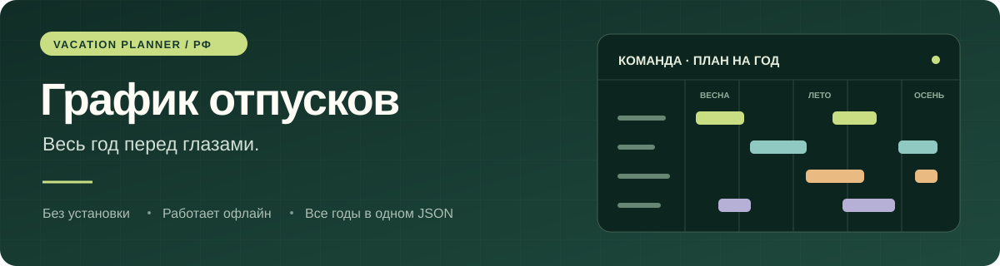
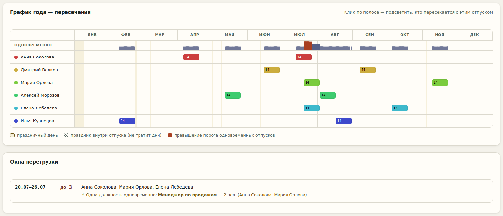

**Планируй отпуска команды, замечай пересечения и сохраняй историю всех лет.**

Один HTML-файл. Без установки. База в твоих «Документах».

[**Открыть в браузере ↗**](https://donshefo.github.io/otpusk-planner-rf/) · [**Скачать приложение ↓**](https://github.com/DonShefo/otpusk-planner-rf/releases/latest/download/vacation-planner.html) · [Что нового](https://github.com/DonShefo/otpusk-planner-rf/releases/latest)

## Весь год на одном экране

Годовой график показывает, кто и когда отдыхает. Приложение выделяет перегруженные периоды и совпадения отпусков сотрудников одной должности. Нажми на полосу, чтобы рассмотреть пересечения.

<picture>
  <source media="(prefers-color-scheme: dark)" srcset="docs/assets/schedule-dark.png">
  
</picture>

Реальный интерфейс на демонстрационных данных. В приложении есть светлая, тёмная и автоматическая тема. [Светлая](docs/assets/schedule-light.png) · [Тёмная](docs/assets/schedule-dark.png)

## Что умеет

| Возможность | Для чего |
| :--- | :--- |
| **Наглядный график** | Отпуска, остаток дней, пересечения и настраиваемый порог одновременного отсутствия. |
| **Праздники России** | Расчёт дат с учётом федеральных праздников. Обновление календаря через интернет по кнопке. |
| **Все годы в одной базе** | У каждого года свой состав, должности, настройки и график. Переходящие отпуска видны в следующем году. |
| **Сохранение в файл** | Автосохранение в подключённый JSON с проверкой записи. Запасной вариант: загрузка и скачивание JSON. |
| **Перенос и восстановление** | Импорт прежних форматов v1/v2/v3, отдельные резервные копии и возврат предыдущей записи. |
| **Excel, печать и темы** | Выгрузка графика в `.xlsx`, светлая печать, масштабирование и запоминание выбранной темы. |

## Начать за три шага

1. **Открой планировщик.** Скачай [`vacation-planner.html`](https://github.com/DonShefo/otpusk-planner-rf/releases/latest/download/vacation-planner.html) и открой в Edge или Chrome. Или используй [веб-версию](https://donshefo.github.io/otpusk-planner-rf/).
2. **Подключи базу.** Нажми **«Сохранить как базу…»** и выбери `vacation-planner-data.json` в своих «Документах». Уже есть база? Нажми **«Открыть базу JSON»**.
3. **Заполни график.** Добавь сотрудников и части отпуска. При подключённом файле изменения сохраняются автоматически; дождись статуса **«Сохранено и проверено»**.

Хочешь сначала посмотреть пример? [Скачай демонстрационную базу](https://raw.githubusercontent.com/DonShefo/otpusk-planner-rf/main/docs/assets/demo.json) и открой её через **«Открыть базу JSON»**. Перед открытием сохрани свою рабочую базу. В примере только вымышленные сотрудники.

> **Переезжаешь на другой терминальный сервер?** Открой тот же JSON из переносимых «Документов». Все годы хранятся внутри файла. Резервную копию сохраняй отдельно кнопкой «Скачать JSON».

## Данные остаются у тебя

Данные сотрудников и отпуска не отправляются на сервер. Приложение работает локально, в том числе без интернета; браузер хранит запасную копию. Сетевой запрос выполняется только по кнопке обновления календаря и содержит год, без данных команды.

Календарь загружается из [xmlcalendar.ru](https://xmlcalendar.ru/) или [его зеркала](https://github.com/xmlcalendar/data). Если источник недоступен или ответ не проходит проверку, прежние даты сохраняются.

**Что учитывать:**

- Прямая запись зависит от браузера и политик организации. Если она запрещена, используй **«Открыть JSON без подключения»** и **«Скачать JSON»**. Скачивание не обновляет исходную базу автоматически.
- Один JSON предназначен для последовательной работы одного пользователя. Одновременное редактирование с разных серверов не поддерживается.
- Региональные праздники не входят во встроенный перечень. Подробности расчёта, проверки календаря и восстановления описаны в руководстве.

## Документация

| Раздел | Что внутри |
| :--- | :--- |
| [**Руководство пользователя**](docs/USER-GUIDE.md) | Файлы, терминальные серверы, годы, импорт, календарь и восстановление. |
| [**Разработка и выпуск**](docs/DEVELOPMENT.md) | Исходники, сборка, проверки, публикация и откат. |
| [**Изменения v3.0.1**](docs/RELEASE-3.0.1.md) | Переносимая база, темы и новый формат выпуска. |
| [**Правила работы с репозиторием**](AGENTS.md) | Инструкции для разработчиков и ИИ-агентов. |

Нашёл ошибку? [Создай issue](https://github.com/DonShefo/otpusk-planner-rf/issues/new) с шагами воспроизведения, версией приложения и браузером. Используй вымышленные имена; рабочие базы сотрудников не прикладывай.

---

**Vacation Planner** · Сделано для планирования отпусков команды 
[MIT License](LICENSE) · [Релизы](https://github.com/DonShefo/otpusk-planner-rf/releases) · [Проверки](https://github.com/DonShefo/otpusk-planner-rf/actions)

